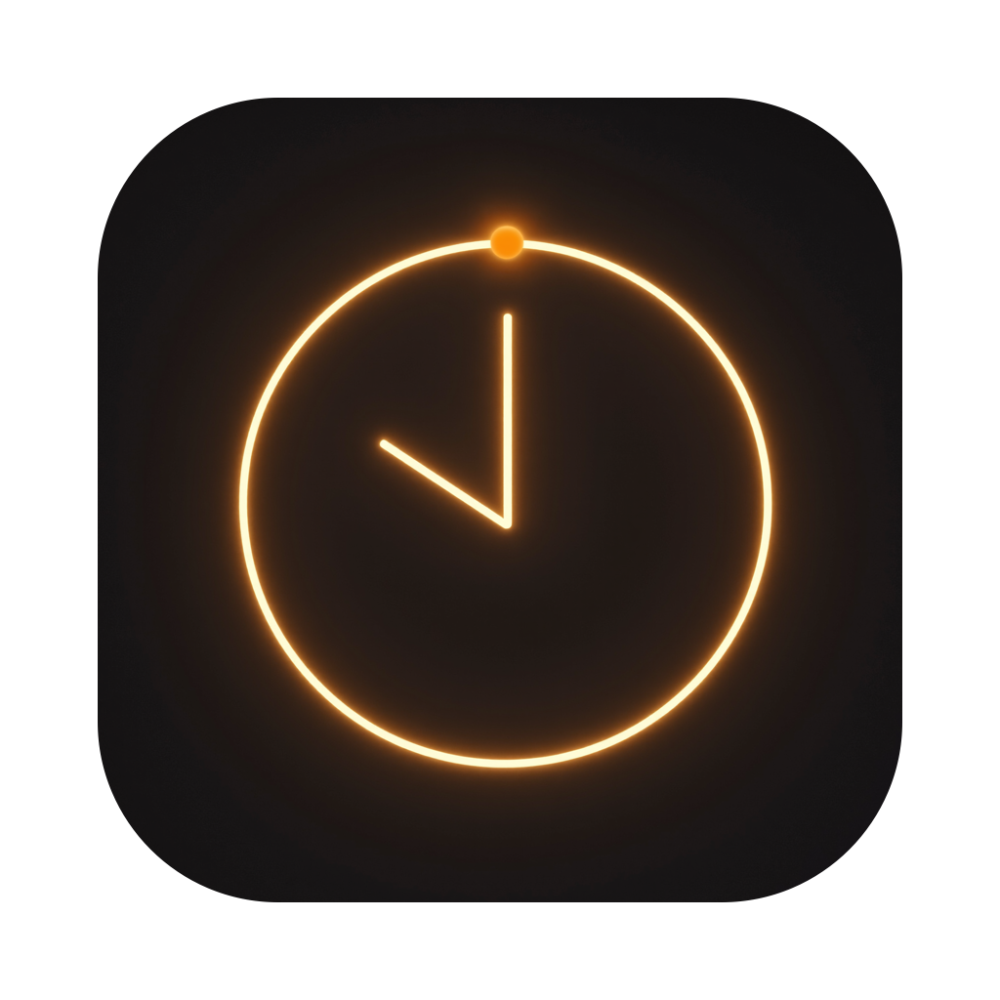

# TinyTimer



A tiny stopwatch and countdown timer that lives in the MacBook notch.

> **This is a fully vibe-coded application.** Every line was written by an AI coding agent from prompts. It works on the author's Mac and is shared as-is: read the code before you trust it, and expect rough edges.

## Get it

**Download a build:** go to [tinytimer.yaraoncode.me](https://tinytimer.yaraoncode.me), or grab the latest build directly: [TinyTimer.zip](https://dl.yaraoncode.me/tinytimer/TinyTimer.zip). Unzip it and drag `TinyTimer.app` into `/Applications`. The build is signed and notarized.

**Or build it yourself:**

```sh
git clone https://github.com/nemish/tinytimer.git
cd tinytimer
./build.sh run
```

`./build.sh run` compiles the app, replaces any existing `/Applications/TinyTimer.app`, and launches it.

## Requirements

- macOS 14 (Sonoma) or later
- To build: the Xcode Command Line Tools (`xcode-select --install`). No Xcode project and no dependencies.
- A MacBook with a notch is the intended home. On a Mac without one, the timer shows as a thin strip at the top centre of the screen.

## What it does

- **Stopwatch** and **countdown** modes. The countdown is 1 to 600 minutes, with quick presets for 5, 15, 25 and 45.
- **Interval chime**: a soft sound every 30 seconds, 1 minute or 5 minutes, either repeating or once.
- **Countdown-end sound**: plays once, or rings until you click the timer (it stops by itself after 1 minute).
- **Sounds**: 13 bundled sounds (single hits and ringtone-style patterns) plus two macOS system sounds, with separate volume for the chime and the countdown end.
- **Sessions**: every countdown that reaches zero adds a dot, Pomodoro style. Dots group into sessions, a new session starts each day, and the history keeps the last 200 sessions.
- **Updates itself**: when a newer version is published, an "Update to x.y" button appears in the expanded panel. One click downloads it, checks its signature, replaces the app and relaunches.
- **Stays out of the way**: no Dock icon, no menu bar item, and it is visible on every Space and over full-screen apps.

## How to use it

| Action | Result |
| --- | --- |
| Hover over the notch | Shows the timer if it is hidden |
| Drag down | Hidden → pinned → expanded |
| Drag up | Expanded → pinned → hidden |
| Click the compact timer | Expands the panel |
| Click the big time, or anywhere outside | Collapses the panel |
| Play button in the compact countdown | Starts the countdown; while running it restarts from the full duration |
| Gear icon | Sound, chime and volume preferences |
| Pin icon | Keeps the timer visible when the mouse is elsewhere |
| Power icon | Quits TinyTimer |

## Privacy

TinyTimer collects nothing. Its only network use is the update check: at launch and once a day it fetches a small version file from `dl.yaraoncode.me`, and it downloads the new build from there when you click Update. Settings and session history are stored locally in macOS user defaults under `app.tinytimer.TinyTimer`. To wipe them:

```sh
defaults delete app.tinytimer.TinyTimer
```

## Building

Everything is in two files: `main.swift` (the whole app) and `build.sh`.

| Command | What it does |
| --- | --- |
| `./build.sh` | Builds `TinyTimer.app` next to the script and runs the self-test |
| `./build.sh run` | Builds, installs to `/Applications` (replacing the old copy) and launches |
| `./build.sh release` | Builds, notarizes, staples, zips and publishes the build to Cloudflare R2 |

The build signs with a Developer ID certificate if one is in your keychain, and falls back to ad-hoc signing if not. An ad-hoc build runs fine on the Mac that built it.

`./build.sh release` is the author's publishing path: bump `VERSION` in `build.sh`, run it, and installed copies offer the update. It needs an Apple Developer account with a saved `notarytool` keychain profile (`NOTARY_PROFILE=your-profile`) and a Cloudflare login for `wrangler` with access to the R2 bucket (`R2_BUCKET=your-bucket`).

If you fork it, note that the updater only installs builds signed by the author's Developer ID team and downloaded from the author's URL; change `Updater.base` and `Updater.requirement` in `main.swift` to ship your own.

The self-test covers the time formatting and chime logic: `TinyTimer.app/Contents/MacOS/TinyTimer --selftest`.

## Uninstall

Quit TinyTimer with the power icon, delete `/Applications/TinyTimer.app`, and optionally run the `defaults delete` command above.

## Ideas and bugs

Have an idea or found a bug? You're welcome to post it in the [issues](https://github.com/nemish/tinytimer/issues).

## License

[MIT](LICENSE)
